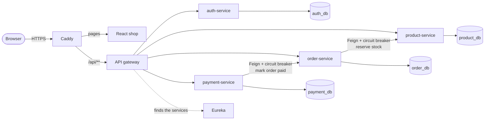

# E-Commerce Platform

[](https://github.com/monssefbaakka/ecommerce-microservices/actions/workflows/ci.yml?query=branch%3Amain+event%3Apush)
[](services/order-service/pom.xml)
[](services/order-service/pom.xml)
[](services/api-gateway/pom.xml)
[](docs/ci.md#published-images)
[](LICENSE)

An e-commerce backend split into Spring Boot microservices (auth, catalog, cart and orders, payments) behind an
API gateway, with a small React shop on top. Every merge to `main` is tested, packaged as Docker images and
deployed to a server behind HTTPS; each request can be followed across the services in Zipkin and Grafana.



## Highlights

- **A database per service.** No service reads another one's tables, no foreign key across databases: the owner
  is asked over HTTP. Schemas are versioned with Flyway and validated by Hibernate at startup; CI rejects a pull
  request that edits a migration already on `main`.
- **Resilient calls between services.** OpenFeign clients behind a Resilience4j circuit breaker and retries. A
  write is never sent twice once it may have reached the other service. When product-service is down, the cart
  is still shown from the last known prices, while ordering waits for fresh data
  ([ADR 0002](docs/adr/0002-circuit-breaker-and-retries-around-feign-calls.md),
  [ADR 0003](docs/adr/0003-fallback-for-the-cart-only.md)).
- **Concurrency handled in the database.** Stock is reserved all-or-nothing under a row lock
  (`SELECT ... FOR UPDATE`): two customers cannot buy the last unit. A double click on "pay" is serialized by a
  PostgreSQL advisory lock. If an order cannot be saved after its stock was reserved, the stock is given back.
- **Security in depth.** Each service checks the JWT itself, without a database call. `/internal/**` endpoints
  are not routed by the gateway and only accept short-lived `SERVICE` tokens. The services have no default signing key.
  Four Docker networks: the public gateway cannot even resolve the PostgreSQL host.
- **Observability.** One trace per request across the gateway and the services (Micrometer Tracing, Zipkin),
  metrics scraped by Prometheus through Eureka, a provisioned Grafana dashboard, business counters (orders,
  payments, cart fallbacks).
- **Tests that hit real infrastructure.** About 13 000 lines of tests for 6 000 lines of code: PostgreSQL in
  Testcontainers, WireMock fake services for the Feign clients (timeouts, dropped connections, circuit breaker
  opening and closing), concurrent orders racing for the same stock.
- **CI/CD.** Every pull request builds and tests the six services and the frontend, then builds each Docker image
  and checks it runs as non-root with a health check. `main` publishes the images to GitHub Container Registry and
  deploys the exact tested commit over SSH, rolling back if a container never becomes healthy.

**Known limits.** The calls between services are synchronous and there is no saga yet: a crash between the stock
reservation and the order save, or a lost "mark paid" call after an accepted card, is not compensated (the card
is simulated), and an unpaid order keeps its stock. An outbox with events would cover these cases; see
[what can go wrong](docs/architecture.md#a-request-through-the-stack).

## Tech stack

| Area | Technology |
|---|---|
| Language, framework | Java 21, Spring Boot 4.1 (Spring Framework 7, Hibernate 7), Spring Web MVC, Spring Data JPA, Bean Validation, MapStruct |
| Microservices | Spring Cloud 2025.1: Eureka, Spring Cloud Gateway, LoadBalancer, OpenFeign; Resilience4j 2.4 |
| Security | Spring Security, JWT (jjwt), BCrypt |
| Database | PostgreSQL 16, one database per service, Flyway |
| Tests | JUnit 5, Mockito, MockMvc, Testcontainers 2, WireMock, JaCoCo; Vitest for the frontend |
| Observability | Spring Boot Actuator, Micrometer, Micrometer Tracing (Brave) and Zipkin, Prometheus, Grafana |
| Frontend | React 19, TypeScript, Vite, React Router, served by nginx |
| Delivery | Docker, Docker Compose, GitHub Actions, GitHub Container Registry, Caddy (HTTPS, Let's Encrypt) |
| API docs | OpenAPI 3 / Swagger UI on each service |

## Quick start

Only Docker is needed:

```bash
docker compose -f infra/docker-compose.yml --profile app up -d --build --wait
```

| URL | What |
|---|---|
| http://localhost:3000 | The shop |
| http://localhost:8090 | The API, through the gateway ([API reference](docs/api.md), [ready-to-run requests](docs/requests.http)) |
| http://localhost:3001 | Grafana (`admin` / `admin`), the overview dashboard and the traces |
| http://localhost:9411 | Zipkin |
| http://localhost:8761 | Eureka dashboard |

To get an `ADMIN` account (catalog admin page), copy `infra/.env.example` to `infra/.env` and set `ADMIN_EMAIL`
and `ADMIN_PASSWORD` before starting. Card numbers ending in `0002` are declined, any other 16 digits are
accepted. To skip the build, the images published by the CI can be pulled instead; to run a service from your IDE
or run the tests, see [development](docs/development.md).

## Documentation

| Document | What is in it |
|---|---|
| [Architecture](docs/architecture.md) | Containers and networks, data ownership, an order and its payment across the services, what can fail and how, security model, pipeline from a commit to the server |
| [Decisions (ADRs)](docs/adr/README.md) | Why OpenFeign, the circuit breaker and retry rules, the cart-only fallback, one server with Compose, Flyway, the observability stack, retiring the monolith |
| [Services](docs/services.md) | Routes, calls between services, circuit breaker, retries, timeouts, fallback |
| [API reference](docs/api.md) | Every endpoint with its codes, roles, error format, Actuator and metrics |
| [Database](docs/database.md) | The tables of each database, Flyway migrations |
| [Development](docs/development.md) | Running the stack or one service, tests, frontend, project structure |
| [CI](docs/ci.md) | What each job checks, the published images and their tags |
| [Deployment](docs/deployment.md) | Setting up the server, the first deploy, roll back, backups |
| [Observability](docs/observability.md) | Following a request in Zipkin, Prometheus, the Grafana dashboard |

## How it was built

The project grew in eight phases, each tracked as GitHub issues and delivered through its own branch and pull
request: a monolith first (catalog, JWT security, cart and orders, tests, Docker), then split into services
strangler-style behind the gateway, then resilience, CI/CD, deployment, the frontend, Flyway and observability.
Once every route had moved to a service, the monolith was removed
([ADR 0007](docs/adr/0007-retire-the-monolith.md)); its last version is kept under the git tag
[`monolith-final`](https://github.com/monssefbaakka/ecommerce-microservices/tree/monolith-final).

## License

MIT
