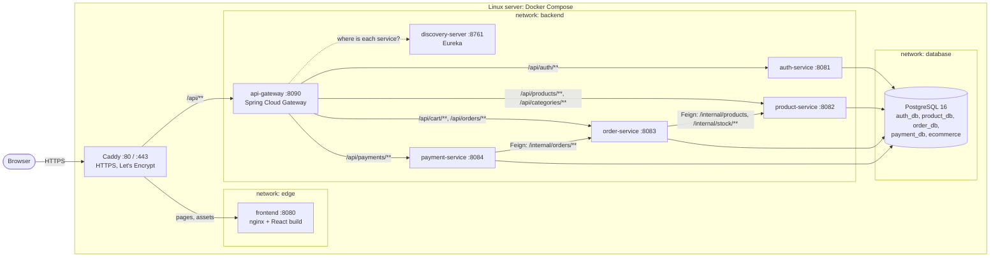
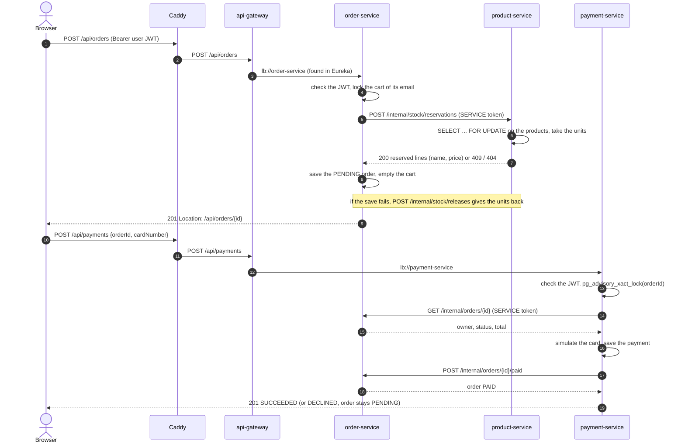
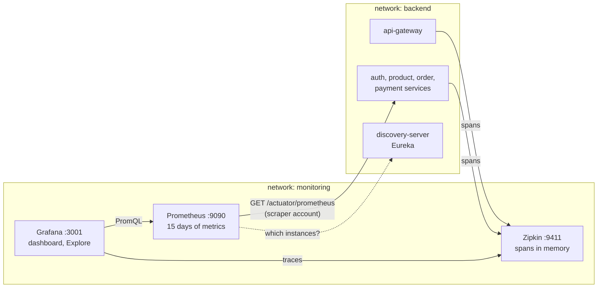
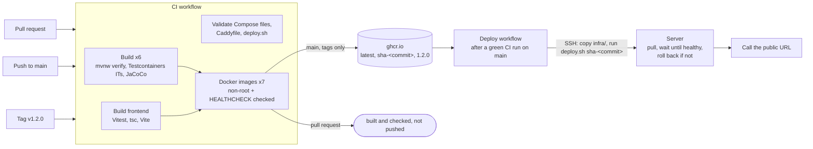

# Architecture

How the platform fits together once every phase is done: what runs where, who talks to whom, how a request
crosses the stack, how it is secured and how a commit reaches the server. The [API reference](api.md) and the
[development guide](development.md) hold the endpoints and the commands; the decisions behind the design are in
[adr/](adr/README.md).

## System overview

A browser only ever talks to Caddy. Caddy sends `/api/**` to the gateway and every other path to the
frontend. The gateway finds the services through Eureka and forwards each request to the one owning the
route. Each service owns its own database in a single PostgreSQL instance.

Every service also registers itself in Eureka and sends it its health; those arrows are left out to keep the
picture readable.

### Containers

| Container | Image | Networks | Published on the server | Role |
|---|---|---|---|---|
| caddy | `caddy:2.11-alpine` | edge | 80, 443 (TCP and UDP) | Only public entry point: HTTPS certificate, compression, `/api/**` to the gateway, the rest to the frontend |
| frontend | `ecommerce-frontend` | edge | - | Static React build served by unprivileged nginx; `index.html` for every route of the app |
| api-gateway | `ecommerce-api-gateway` | edge, backend | - | Routes `/api/**` to the services by their Eureka name, uniform `ErrorResponse`, timeouts |
| discovery-server | `ecommerce-discovery-server` | backend | `127.0.0.1:8761` (through an SSH tunnel) | Eureka registry |
| auth-service | `ecommerce-auth-service` | backend, database | - | Accounts, login, JWT signing |
| product-service | `ecommerce-product-service` | backend, database | - | Categories, products, stock |
| order-service | `ecommerce-order-service` | backend, database | - | Carts and orders |
| payment-service | `ecommerce-payment-service` | backend, database | - | Simulated card payments |
| postgres | `postgres:16-alpine` | database | - | One instance, one database per owner, created by `infra/postgres/init-databases.sql` |
| zipkin | `openzipkin/zipkin:3.6` | backend, monitoring | `127.0.0.1:9411` (through an SSH tunnel) | Receives the spans of the gateway and the services; keeps the last 100 000 in memory |
| prometheus | `prom/prometheus:v3.15.1` | backend, monitoring | `127.0.0.1:9090` (through an SSH tunnel) | Scrapes `/actuator/prometheus` every 15 s, services found through Eureka; 15 days of history |
| grafana | `grafana/grafana:13.1` | monitoring | `127.0.0.1:3001` (through an SSH tunnel) | Dashboard over Prometheus, traces of Zipkin in Explore; provisioned from `infra/grafana`, no volume |

### Networks

The four Docker networks split who can reach whom, independently of the published ports:

- **edge**: Caddy, the frontend and the gateway. From the public side, nothing behind the gateway can even be
  resolved: a bug in nginx or Caddy cannot reach a service, Eureka or PostgreSQL directly.
- **backend**: the gateway, Eureka and the services. Calls between services stay here.
- **database**: PostgreSQL and the four services that own a database. The gateway and Eureka are not on
  it.
- **monitoring**: Grafana, Prometheus and Zipkin. Prometheus and Zipkin are also on backend, to scrape the
  applications and receive their spans; Grafana is only here, it reaches no service, Eureka or PostgreSQL.

On a laptop (`infra/docker-compose.yml` alone) each service also publishes its port on the host, to call it
directly or open its Swagger UI. The production override (`infra/docker-compose.prod.yml`) removes them all;
CI fails if any port other than Caddy's is published on every interface.

### Data ownership

| Database | Owner | Tables |
|---|---|---|
| `auth_db` | auth-service | `users` |
| `product_db` | product-service | `categories`, `products` |
| `order_db` | order-service | `carts`, `cart_items`, `orders`, `order_items` |
| `payment_db` | payment-service | `payments` |

No service reads another one's tables and there is no foreign key between databases. A row keeps the
`productId`, `orderId` or user email it refers to, and the owner is asked over HTTP when the current value
matters (price, stock, order status).

Each owner also owns the **schema** of its database: its Flyway scripts (`src/main/resources/db/migration`) run
when it starts, before JPA, and are recorded in the `flyway_schema_history` table of that database. Hibernate
only validates the tables against the entities. A schema change is deployed with the service that needs it,
never as a separate step ([ADR 0005](adr/0005-flyway-migrations-instead-of-hibernate-ddl.md)).

## A request through the stack

Placing an order, then paying it, touches every layer. The JWT travels with each request from the browser;
the calls between services carry a short-lived `SERVICE` token instead.

What can go wrong on the way, and what the user gets:

| Failure | Where it is caught | Answer |
|---|---|---|
| Product short on stock | product-service, under the row lock | **409**, nothing reserved, cart untouched |
| Two clicks on "order" | order-service, cart lock | One order; the second request finds the cart empty (**400**) |
| Two clicks on "pay" | payment-service, advisory lock | One payment; the second finds the order `PAID` (**409**) |
| Order never paid | order-service, expiry job every minute | `CANCELLED` after 30 minutes, its units back in stock; while product-service is down it stays `PENDING` and is tried again |
| Cancellation and payment of the same order at once | order-service, row lock on the order | The first one wins, the second gets a **409** |
| product-service or order-service down, slow or failing | Feign client, retries then circuit breaker | **503** at once while the breaker is open ([ADR 0002](adr/0002-circuit-breaker-and-retries-around-feign-calls.md)) |
| product-service down while showing the cart | order-service fallback | **200** with the last known names and prices, `productsUpToDate: false` ([ADR 0003](adr/0003-fallback-for-the-cart-only.md)) |
| Service not registered in Eureka | gateway | **503** |
| Service answers after 15 s | gateway | **504** |
| Crash between the stock reservation and the order save, or `PAID` call lost after an accepted card | nowhere yet | Not compensated: the card is simulated. A saga or an outbox would cover it |
| Order cancelled or expired after payment-service checked it, before the card is charged | payment-service, `PAID` call refused (**409**) | The payment is not saved, but the card was charged: a real one would need a refund. An outbox would cover it |
| Release of the stock times out on a cancellation | nowhere yet | The order stays `PENDING`; if product-service did take the units back, they are given back again on the next try |

## Observability

Each request gets a **trace**: the gateway starts it (or continues the W3C `traceparent` of the client) and
passes it to the service, the Feign calls carry it to the next service. Every application sends its spans to
Zipkin, and writes the trace id in each log line. Prometheus **pulls** the metrics of every application, and
Grafana shows them next to the traces.

For an order, one trace holds the span of the gateway, the span of `POST /api/orders` in order-service, and
under it the Feign calls to product-service with their own server spans: Zipkin shows which one was slow or
failed. The health checks, the scrapes and the Eureka client calls are not traced, and not counted in the HTTP
metrics. The gateway and Eureka are traced but not scraped: they check no token, so they expose no metrics.
Why these tools: [ADR 0006](adr/0006-zipkin-prometheus-and-grafana-for-observability.md).

## Security

| Layer | How it is protected |
|---|---|
| Transport | Caddy terminates HTTPS with a Let's Encrypt certificate it renews itself; HTTP is redirected |
| Exposure | Only Caddy publishes a port on the server; Eureka, Zipkin, Prometheus and Grafana listen on the loopback, reached through an SSH tunnel |
| Identity | auth-service hashes passwords with BCrypt and signs a JWT (HS256, `sub` = email, `role`, 1 h) |
| Authorization | Each service checks the signature, expiry and role of the token itself, without a database call: the gateway forwards the `Authorization` header and checks nothing |
| Roles | `USER` for every account created by `/register`; `ADMIN` only for the account created at start-up from `ADMIN_EMAIL` / `ADMIN_PASSWORD`; `SERVICE` only for tokens a service signs for its own calls |
| Internal endpoints | `/internal/**` is not routed by the gateway and only accepts a `SERVICE` token |
| Ownership | The email of the token picks the cart, orders and payments: another user's order answers **404**, like a missing one |
| Secrets | `JWT_SECRET`, `POSTGRES_PASSWORD`, `METRICS_PASSWORD` and `GRAFANA_ADMIN_PASSWORD` live in `infra/.env` on the server; the production Compose file refuses to start without them, and the services have no default JWT key (CI checks it). GitHub only holds the SSH key of the deploy user |
| Containers | Every image runs as a non-root user and has a `HEALTHCHECK`; CI fails an image that does not |
| Actuator | `health` and `info` are public, `metrics` and `flyway` need an `ADMIN` token, `prometheus` only opens to the scraper account (HTTP Basic, in a filter chain of its own), every other endpoint is closed. The gateway and Eureka do not expose their metrics |

The same `JWT_SECRET` must be set in auth-service, product-service, order-service and payment-service: a token
signed by one is accepted by all of them. The services have no default key: started without `JWT_SECRET`, they
stop at startup. Only the local Compose file sets a dev-only key, so that `docker compose up` works as is.

## From a commit to the server

- An image is only built from code whose tests passed, and only pushed from `main` or a release tag.
- The server always runs an exact commit (`sha-<commit>`), never `latest`. A roll back is a manual run of the
  *Deploy* workflow with an older tag.
- `deploy.sh` keeps the previous version and starts it again if a container of the new one never becomes
  healthy.

Details: [CI](ci.md) and the
[deployment guide](deployment.md).

## Architecture decisions

The choices that shaped this design, with the alternatives considered, are recorded as ADRs in
[adr/](adr/README.md): OpenFeign between services, the circuit breaker and retry rules, why only the cart has a
fallback, why the stack runs on a single server with Docker Compose, why Flyway owns the schema instead of
Hibernate, how the requests are traced and the metrics collected (Zipkin, Prometheus, Grafana), and why the
monolith was retired once every route had moved to a service.
