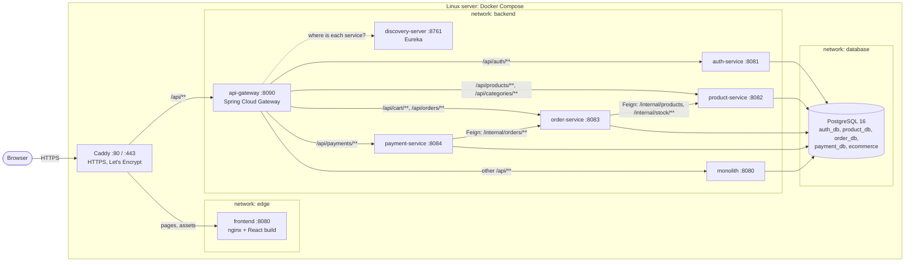

# Architecture

How the platform fits together once every phase is done: what runs where, who talks to whom, how a request
crosses the stack, how it is secured and how a commit reaches the server. The [README](../README.md) holds the
endpoints and the commands; the decisions behind the design are in [adr/](adr/README.md).

## System overview

A browser only ever talks to Caddy. Caddy sends `/api/**` to the gateway and every other path to the
frontend. The gateway finds the services through Eureka and forwards each request to the one owning the
route. Each service owns its own database in a single PostgreSQL instance.

Every service also registers itself in Eureka and sends it its health; those arrows are left out to keep the
picture readable.

### Containers

| Container | Image | Networks | Published on the server | Role |
|---|---|---|---|---|
| caddy | `caddy:2.11-alpine` | edge | 80, 443 (TCP and UDP) | Only public entry point: HTTPS certificate, compression, `/api/**` to the gateway, the rest to the frontend |
| frontend | `ecommerce-frontend` | edge | - | Static React build served by unprivileged nginx; `index.html` for every route of the app |
| api-gateway | `ecommerce-api-gateway` | edge, backend | - | Routes `/api/**` to the services by their Eureka name, uniform `ErrorResponse`, timeouts |
| discovery-server | `ecommerce-discovery-server` | backend | `127.0.0.1:8761` (through an SSH tunnel) | Eureka registry |
| auth-service | `ecommerce-auth-service` | backend, database | - | Accounts, login, JWT signing |
| product-service | `ecommerce-product-service` | backend, database | - | Categories, products, stock |
| order-service | `ecommerce-order-service` | backend, database | - | Carts and orders |
| payment-service | `ecommerce-payment-service` | backend, database | - | Simulated card payments |
| app (monolith) | `ecommerce-monolith` | backend, database | - | Phases 1 to 4; still answers the `/api/**` routes no service owns |
| postgres | `postgres:16-alpine` | database | - | One instance, one database per owner, created by `infra/postgres/init-databases.sql` |

### Networks

The three Docker networks split who can reach whom, independently of the published ports:

- **edge**: Caddy, the frontend and the gateway. From the public side, nothing behind the gateway can even be
  resolved: a bug in nginx or Caddy cannot reach a service, Eureka or PostgreSQL directly.
- **backend**: the gateway, Eureka, the services and the monolith. Calls between services stay here.
- **database**: PostgreSQL and the five applications that own a database. The gateway and Eureka are not on
  it.

On a laptop (`infra/docker-compose.yml` alone) each service also publishes its port on the host, to call it
directly or open its Swagger UI. The production override (`infra/docker-compose.prod.yml`) removes them all;
CI fails if any port other than Caddy's is published on every interface.

### Data ownership

| Database | Owner | Tables |
|---|---|---|
| `auth_db` | auth-service | `users` |
| `product_db` | product-service | `categories`, `products` |
| `order_db` | order-service | `carts`, `cart_items`, `orders`, `order_items` |
| `payment_db` | payment-service | `payments` |
| `ecommerce` | monolith | its own copy of every table above |

No service reads another one's tables and there is no foreign key between databases. A row keeps the
`productId`, `orderId` or user email it refers to, and the owner is asked over HTTP when the current value
matters (price, stock, order status).
