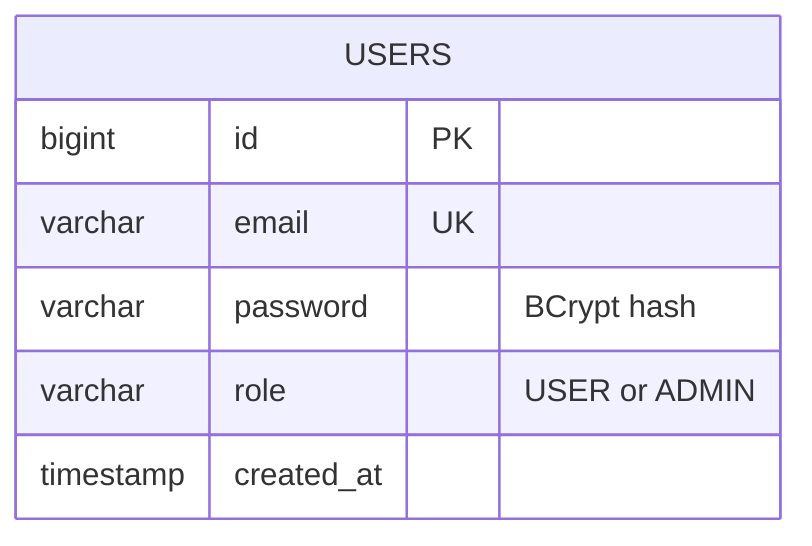
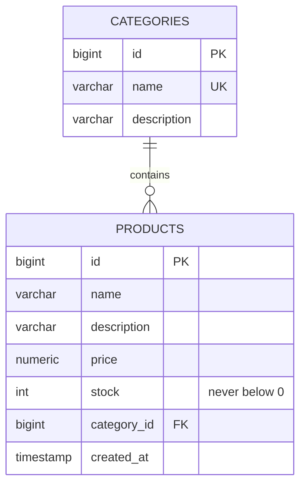
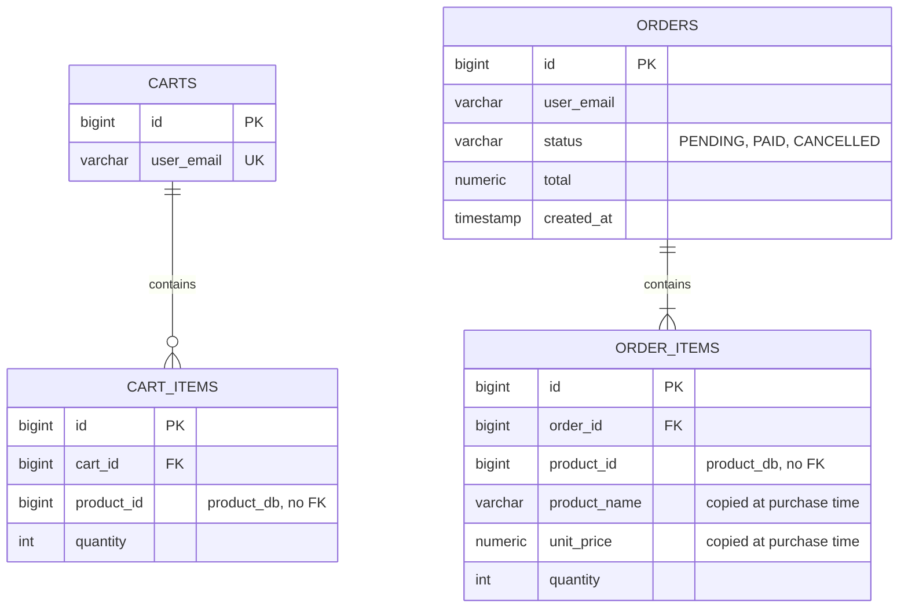
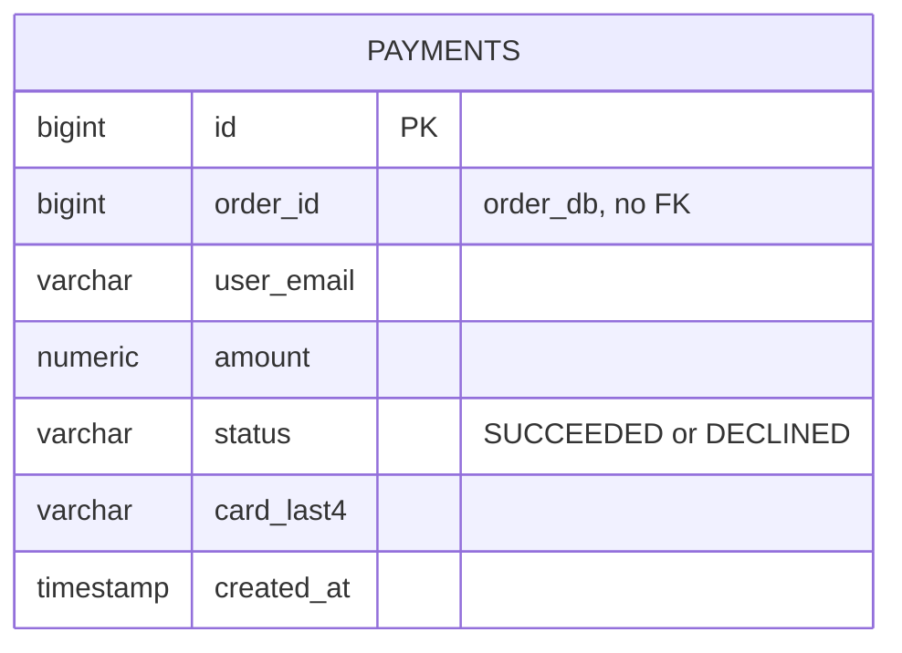

# Database schema

One PostgreSQL server, one database per service. No service reads another one's tables and there is no foreign
key between two databases: a row keeps the `user_email`, `product_id` or `order_id` it refers to, and the owner
is asked over HTTP when the current value matters (price, stock, order status).

`auth_db`, owned by auth-service.

`product_db`, owned by product-service. The stock is taken and given back through `/internal/stock/**`, under a
row lock (`SELECT ... FOR UPDATE`).

`order_db`, owned by order-service.

`payment_db`, owned by payment-service.

An order keeps a copy of the name and price of each product at purchase time: it does not change if the product
is updated or deleted later. `payments` keeps each payment attempt (accepted or declined); an accepted one sets
`orders.status` to `PAID` through order-service.

## Migrations

The tables are created by [Flyway](https://documentation.red-gate.com/flyway), not by Hibernate. Each service that
owns a database has its scripts in `src/main/resources/db/migration`, run in order at startup, before JPA:

| Service | Database | Scripts |
|---|---|---|
| auth-service | `auth_db` | `V1` users, `V2` index on `upper(email)` |
| product-service | `product_db` | `V1` categories, `V2` products, `V3` index on `products.category_id` |
| order-service | `order_db` | `V1` carts, `V2` orders, `V3` indexes on `orders.user_email` and `order_items.order_id` |
| payment-service | `payment_db` | `V1` payments, `V2` index on `payments.user_email` |

Flyway records each script it ran, with a checksum, in the `flyway_schema_history` table of that database, and
never runs it again. Hibernate only checks the result (`ddl-auto: validate`): if an entity has a column that no
script created, the service stops at startup instead of failing on the first query.

**Changing the schema:** add a new script with the next version, for example `V4__add_product_image_url.sql` in
product-service, next to the entity change. Never edit a script that is already on `main`: it has run on the
server, its checksum would no longer match and the service would refuse to start (the CI
[rejects it](ci.md#migrations-job)). The integration tests run every script on an empty PostgreSQL and validate
the entities against the result, so `./mvnw verify` catches a script that fails or one that was forgotten.

**Databases created before Flyway:** until #115, Hibernate created the tables (`ddl-auto: update`). The first
scripts create exactly the same tables, with the same constraint names. On a database that already has them and
no `flyway_schema_history`, Flyway does not fail: it records the existing schema as the last of those scripts
(`baseline-version`: 1 for auth-service and payment-service, 2 for product-service and order-service) and only
runs the scripts after it, the indexes. `FlywayMigrationIT` in each service loads the DDL that Hibernate used to
run, baselines it, and checks that it ends with the same columns, constraints and indexes as a database migrated
from `V1`. Why Flyway: [ADR 0005](adr/0005-flyway-migrations-instead-of-hibernate-ddl.md).

To see what ran on a database: `SELECT version, description, installed_on, success FROM flyway_schema_history
ORDER BY installed_rank;` in `psql`, or [`/actuator/flyway`](api.md#health-actuator) with an ADMIN token.
