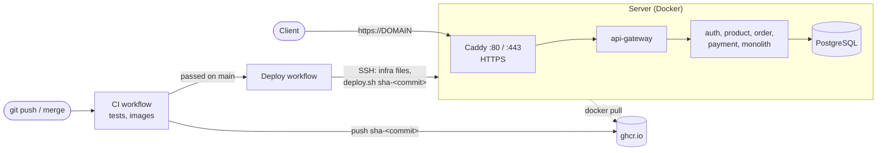

# Deployment

The whole stack runs on **one Linux server with Docker**, from the images that the CI publishes on GitHub
Container Registry: nothing is built on the server. Each merge to `main` is deployed automatically once its
tests pass. Why one server and Docker Compose rather than a PaaS or Kubernetes: [ADR 0004](adr/0004-deploy-on-a-single-server-with-docker-compose.md).



| File | Role |
|---|---|
| [infra/docker-compose.prod.yml](../infra/docker-compose.prod.yml) | Merged over `docker-compose.yml` and `docker-compose.ghcr.yml`: no port published but Caddy's, secrets required, Caddy in front of the gateway |
| [infra/caddy/Caddyfile](../infra/caddy/Caddyfile) | HTTPS for `DOMAIN` (Let's Encrypt certificate, renewed by Caddy), everything sent to the gateway |
| [infra/deploy.sh](../infra/deploy.sh) | Run on the server: pulls one image version, waits until every container is healthy, rolls back if one is not |
| [.github/workflows/deploy.yml](../.github/workflows/deploy.yml) | After CI passed on `main`: copies `infra/` to the server over SSH and runs `deploy.sh` with the image of that commit |

## What you need

- A Linux server with a public IP address: **x86_64** (the images are built for `linux/amd64` only, an ARM
  server cannot run them), **4 GB of RAM** at least, 2 vCPUs, 20 GB of disk. Ubuntu 24.04 is used below; any
  distribution with Docker works. Most cloud providers sell such a machine for a few euros a month.
- SSH access to it.
- A domain name pointing to its IP address (an `A` record), or none: `<IP with dashes>.sslip.io` resolves
  to the IP written in it (`203-0-113-10.sslip.io` → `203.0.113.10`), and Let's Encrypt gives it a certificate.

Seven JVMs are limited to 512 MB each in Compose, plus PostgreSQL and Caddy. Once started they use about
2 to 2.5 GB together (`docker stats`): 4 GB leaves room for the system and the peaks.

## 1. Prepare the server (once)

As `root` on the server:

```bash
# Docker Engine and the Compose plugin (2.24.4 or later is needed by docker-compose.prod.yml)
curl -fsSL https://get.docker.com | sh

# A user for the deployments, allowed to use Docker
adduser --disabled-password --gecos "" deploy
usermod -aG docker deploy

# Firewall: SSH, HTTP and HTTPS (HTTP/3 over UDP)
ufw allow OpenSSH
ufw allow 80/tcp
ufw allow 443/tcp
ufw allow 443/udp
ufw --force enable
```

> Being in the `docker` group is the same as being `root` on that machine (a container can mount `/`). Keep
> the private key of `deploy` only in the GitHub secret below.

Docker writes its own firewall rules for the published ports, before those of `ufw`: a port published by a
container is open to the internet whatever `ufw` says. That is why `docker-compose.prod.yml` publishes no port
of the stack except Caddy's 80 and 443, and Eureka's dashboard on `127.0.0.1` only. The CI fails if another
port gets published on every interface.

## 2. Secrets, on the server only

As `deploy` (`su - deploy`), create `~/ecommerce/infra/.env`. It never leaves the server: the deploy workflow copies the
other files of `infra/` next to it and never touches it.

```bash
mkdir -p ~/ecommerce/infra
cd ~/ecommerce/infra
cat > .env <<EOF
JWT_SECRET=$(openssl rand -base64 32)
POSTGRES_PASSWORD=$(openssl rand -hex 24)
DOMAIN=shop.example.com
ADMIN_EMAIL=admin@example.com
ADMIN_PASSWORD=$(openssl rand -hex 12)
EOF
chmod 600 .env
cat .env   # note the ADMIN_PASSWORD
```

| Variable | |
|---|---|
| `JWT_SECRET` | Required. Signs and checks the tokens in every service |
| `POSTGRES_PASSWORD` | Required. Read by PostgreSQL when its volume is created, the first time only: to change it later, `ALTER USER ecommerce PASSWORD '...'` in `psql`, then the new value here |
| `DOMAIN` | The domain served over HTTPS. Not set: plain HTTP on port 80 (to test with the IP address only) |
| `ADMIN_EMAIL`, `ADMIN_PASSWORD` | Optional. An ADMIN account created at startup, to manage the catalog |

The other variables of [.env.example](../infra/.env.example) work the same as locally.

## 3. Deploy key and GitHub settings

On your machine, a key pair used only by the deploy workflow:

```bash
ssh-keygen -t ed25519 -N "" -C "github-actions-deploy" -f deploy_key

# Authorized for "deploy" (which has no password), through your root access
cat deploy_key.pub | ssh root@203.0.113.10 'install -d -m 700 -o deploy -g deploy ~deploy/.ssh &&
  cat >> ~deploy/.ssh/authorized_keys && chown deploy:deploy ~deploy/.ssh/authorized_keys && chmod 600 ~deploy/.ssh/authorized_keys'

# The host key of the server, which the workflow will accept and no other
ssh-keyscan -t ed25519 203.0.113.10 > known_hosts
ssh-keygen -lf known_hosts        # compare with "ssh-keygen -lf /etc/ssh/ssh_host_ed25519_key.pub" run on the server
```

Then in the repository, *Settings* → *Secrets and variables* → *Actions*, or with the GitHub CLI:

```bash
gh secret set DEPLOY_SSH_KEY < deploy_key
gh variable set DEPLOY_HOST --body 203.0.113.10
gh variable set DEPLOY_USER --body deploy
gh variable set DEPLOY_KNOWN_HOSTS < known_hosts
gh variable set DEPLOY_URL --body https://shop.example.com
rm deploy_key                     # it now only lives in the GitHub secret
```

| Name | Kind | |
|---|---|---|
| `DEPLOY_SSH_KEY` | secret | Private key of `deploy` |
| `DEPLOY_HOST` | variable | IP address or host name of the server. **Not set: the deploy workflow is skipped** |
| `DEPLOY_USER` | variable | `deploy` |
| `DEPLOY_KNOWN_HOSTS` | variable | Output of `ssh-keyscan`: the runner refuses any other machine answering on that address |
| `DEPLOY_URL` | variable | Public URL. Checked after each deploy, shown on the *production* environment |
| `DEPLOY_PORT` | variable | Optional, SSH port, `22` by default |
| `DEPLOY_DIR` | variable | Optional, folder of the stack in the home of `DEPLOY_USER`, `ecommerce` by default |

The host key is public, a variable is enough. The secret and variables are set at the repository level: the
workflow reads `DEPLOY_HOST` to decide whether to run at all, before any environment is loaded.

## 4. First deploy

*Actions* → *Deploy* → *Run workflow* on `main`, tag left empty: it deploys the image of the last commit of
`main`. Or merge a pull request.

The first start takes a few minutes: the server pulls seven images, PostgreSQL creates the databases, and Caddy
gets the certificate of `DOMAIN` (ports 80 and 443 must already reach the server for that). Then:

```bash
curl https://shop.example.com/api/products
```

## Each merge to main

1. The [CI](../.github/workflows/ci.yml) tests every project and pushes its images, tagged
   `sha-<7 first characters of the commit>` (and `latest`).
2. Once that run passed, the [Deploy workflow](../.github/workflows/deploy.yml) starts. It runs on a push to
   `main` only: not on a pull request, not on a failed or cancelled CI run, not on a release tag. One deploy at a time.

| Step | What it does |
|---|---|
| Pick the version | `sha-<commit>` of the commit that CI just tested. Never `latest`: if `main` moved on in the meantime, the server still gets exactly what passed the tests |
| Checkout | `infra/` of that commit only |
| Set up SSH | The private key from the secret, the host key from `DEPLOY_KNOWN_HOSTS` |
| Copy the stack files | `infra/` sent as a tar stream over SSH (no rsync or git on the server). `infra/.env` stays as it is |
| Deploy | `deploy.sh sha-<commit>` on the server, see below |
| Check the site | `GET $DEPLOY_URL/api/products?size=1` from the internet, through Caddy, the gateway, product-service and its database |
| Summary | Version, commit and URL in the job summary, and a deployment on the *production* environment |

[deploy.sh](../infra/deploy.sh) pulls every image of that version first: if one is missing, nothing is
stopped. Then `docker compose up --wait` recreates only the containers whose image changed and waits until each
one is healthy (5 min at most). If one never gets healthy, the version that ran before (kept in
`infra/.deployed-tag`) is started again and the deploy fails: the server is left with a working stack.
Finally, the images no container uses and older than a week are deleted.

While a container is recreated, its service is unavailable for a few seconds: the gateway answers **503**
for it, and Caddy holds the requests for up to 30 s while the gateway itself restarts (no **502**).

To approve each deploy by hand, add required reviewers to the *production* environment
(*Settings* → *Environments*): the job then waits for a click.

## Roll back

*Actions* → *Deploy* → *Run workflow*, with an older tag: `sha-1a2b3c4` (any commit of `main` since the images
were published) or a release like `1.0.0`. Or directly on the server:

```bash
~/ecommerce/infra/deploy.sh sha-1a2b3c4
```

The Compose files used are those of the branch picked in *Run workflow* (or those already on the server), not
those of the old version: fine as long as they did not change in an incompatible way in between.

## On the server

```bash
cd ~/ecommerce/infra
alias dc='docker compose -f docker-compose.yml -f docker-compose.ghcr.yml -f docker-compose.prod.yml --profile app'

dc ps                                     # state and health of every container
cat .deployed-tag                         # version running
docker logs -f ecommerce-order-service    # logs of one service (rotated at 10 MB, 3 files)
docker stats                              # memory and CPU of each container
docker exec -it ecommerce-postgres psql -U ecommerce -d order_db
```

The Eureka dashboard is only on the server's loopback: `ssh -L 8761:localhost:8761 deploy@203.0.113.10`,
then `http://localhost:8761` on your machine. The services' Actuator endpoints are not reachable from the
internet (the gateway does not route `/actuator/**`).

The containers restart by themselves after a crash or a reboot of the server (`restart: unless-stopped`).

### Backups

All the data is in the PostgreSQL volume. A daily dump of every database, kept 14 days (`crontab -e` as `deploy`):

```bash
0 3 * * * mkdir -p ~/backups && docker exec ecommerce-postgres pg_dumpall -U ecommerce | gzip > ~/backups/db-$(date +\%F).sql.gz && find ~/backups -name 'db-*.sql.gz' -mtime +14 -delete
```

Copy them off the server too (another machine, an object storage): a dump next to the database is lost with it.
To restore one on a fresh volume: `gunzip -c db-2026-11-13.sql.gz | docker exec -i ecommerce-postgres psql -U ecommerce -d postgres`
(the errors about the role and the databases that already exist can be ignored: the volume created them on its first start).

## Limits

- **One server:** if it goes down, the site is down. No load balancing between servers, and PostgreSQL runs
  next to the applications.
- **A few seconds of downtime per deploy** for each service whose image changed (one container per service).
- **No central logs or metrics:** `docker logs` and `/actuator/metrics` (ADMIN token) on each service.
- **amd64 only:** an ARM server would need images built for `linux/arm64` too.
