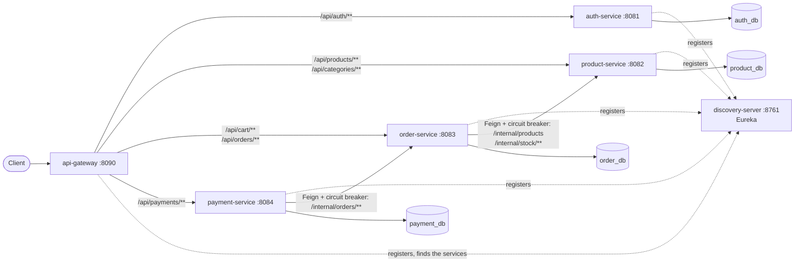

# Services and the calls between them

The services live in [services/](../services/). The diagram below shows the routes and the calls between services; the full picture, with Caddy, the frontend and the Docker networks, is in [architecture.md](architecture.md).

| Service | Port | Role |
|---|---|---|
| [discovery-server](../services/discovery-server) | 8761 | Eureka registry: each service registers under its name, the gateway asks it where they are |
| [auth-service](../services/auth-service) | 8081 | `POST /api/auth/register` and `POST /api/auth/login`: accounts, BCrypt passwords, JWT signing |
| [product-service](../services/product-service) | 8082 | Catalog: CRUD on `/api/categories` and `/api/products` (paging, name search, category filter), stock reserved and released for order-service |
| [order-service](../services/order-service) | 8083 | Cart and orders: `/api/cart` and `/api/orders` (stock checks, price copied at purchase time, cancellation). The stock is reserved in product-service, and given back when an order is cancelled or left unpaid for 30 minutes |
| [payment-service](../services/payment-service) | 8084 | `/api/payments` pays a `PENDING` order with a simulated card; a success sets the order to `PAID` in order-service |
| [api-gateway](../services/api-gateway) | 8090 | Single entry point: `/api/auth/**` to auth-service, `/api/products/**` and `/api/categories/**` to product-service, `/api/cart/**` and `/api/orders/**` to order-service, `/api/payments/**` to payment-service (`lb://...`, found through Eureka); any other path gets a **404** |

- **Same tokens everywhere:** auth-service signs the JWTs, and a token from `/api/auth/login` works on every service. product-service, order-service and payment-service check them the same way, without a database call: only an `ADMIN` token can write the catalog, and the email of the token picks the cart, orders and payments. Every service needs the same `JWT_SECRET`: none has a default.
- **A database per service:** auth-service owns `users` in `auth_db`, product-service `categories` and `products` in `product_db`, order-service `carts` and `orders` in `order_db`, payment-service `payments` in `payment_db`. No service reads the tables of another one, and there is no foreign key between databases: a cart line or an order keeps the `productId`, a cart, an order or a payment keeps the email of the token.
- **Calls between services:** what used to be a join is now an HTTP call, through an OpenFeign client: an interface (`ProductServiceApi`, `OrderServiceApi`) whose `@FeignClient` name is the Eureka name of the other service, resolved by the LoadBalancer on each call (no host or port to configure). order-service reads names, prices and stock from product-service and reserves the stock when an order is placed (all lines or none, **409** if one is short); payment-service reads the owner, status and total of an order and sets it `PAID` in order-service. These endpoints are under `/internal/**`: the gateway does not route them, and they only accept a short-lived token with the `SERVICE` role, which the calling service signs itself with the shared JWT key (no account ever gets this role). A **404** or **409** of the other service is passed on with its message (a Feign `ErrorDecoder`); if it is down, not registered, rejects the token or answers too late, the answer is **503**.
- **Circuit breaker:** each call to another service goes through a Resilience4j circuit breaker named after it (`product-service`, `order-service`), counted once per call after its retries. When half of the last 10 calls failed or took more than 3 s (5 calls at least), it opens: for 10 s the calls answer **503** at once, without any request or timeout, then 3 calls are let through to test the service again. A **404** or **409** is an answer, it counts as a success. Each change of state is logged (`Circuit breaker of product-service: State transition from CLOSED to OPEN`).
- **Fallback, for showing the cart only:** with product-service unavailable (down, failing or its circuit breaker open), the cart is still shown, **200**, with the names and prices order-service saw last and `"productsUpToDate": false`; a line whose product it never saw keeps its quantity, without name nor price, and the total is `null`. Adding to the cart, changing a quantity, placing an order and paying keep their **503**: they decide something from the stock, the prices or the status of the order, which must be current. See [ADR 0003](adr/0003-fallback-for-the-cart-only.md).
- **Retries:** at most 3 attempts, 200 ms then 400 ms apart. A read (`GET`) is sent again after a refused or dropped connection, a 5xx or no instance in Eureka yet, never after a timeout: a hanging service would hang again. A write (`POST`: reserve or release the stock, mark an order paid) is sent again only when it never left (connection refused, unknown host), so the other service never does it twice. With an instance down out of two, the LoadBalancer sends the next attempt to the other one and the user sees nothing. The JDK client under Feign never resends a `POST` by itself either (`sun.net.http.retryPost=false`).
- **Timeouts and logs of the Feign clients:** 2 s to connect and 5 s to read (`FEIGN_CONNECT_TIMEOUT`, `FEIGN_READ_TIMEOUT`, in ms) instead of the Feign defaults of 10 s and 60 s, so a hanging service gives a quick **503**. Each call and its answer is logged at `DEBUG` (method, URL, status, time), never the headers, so never the `SERVICE` token.
- **Unpaid orders:** an order cancelled by its user, or still `PENDING` 30 minutes after it was placed (`ORDER_PENDING_TIMEOUT`), becomes `CANCELLED` and order-service gives its units back (`POST /internal/stock/releases`). A job of each instance looks for them every minute (`ORDER_EXPIRY_CHECK_INTERVAL`), 100 at most per run, and cancels each one in its own transaction, under the same row lock as a payment: an order paid meanwhile is left alone, and two instances never cancel the same order twice. The status is written, then the stock released, then the transaction commits: if product-service refuses or is down, the order stays `PENDING` with its stock and the job tries again on its next run.
- **No distributed transaction:** if the order cannot be saved after the stock was reserved, order-service gives the units back. A crash between the two, or a failure of the `PAID` call after the card was accepted, is not compensated yet (the card is simulated). A saga or an outbox would cover these cases.
- **Errors from the gateway** use the same `ErrorResponse` format: **404** when no route matches, **503** when the target service is not registered in Eureka or does not answer, **504** when it answers after 15 s.
- **Timeouts of the gateway:** 2 s to connect and 15 s for the answer on every route (`GATEWAY_CONNECT_TIMEOUT` in ms, `GATEWAY_RESPONSE_TIMEOUT`), instead of no limit at all. 15 s is longer than two calls between services in a row (5 s each), so the **503** of a service comes first.
- **Health:** each service sends its Actuator status to Eureka. If a service loses PostgreSQL it becomes `DOWN` there and the gateway stops sending it traffic. The gateway does not expose its `gateway` Actuator endpoint (it lists and changes the routes).
